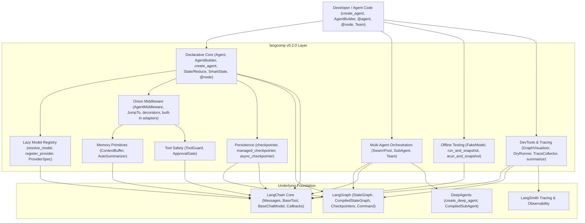

# Chapter 00: Overview & Architecture

## Why `langcomp`?

The LangChain ecosystem—**LangChain**, **LangGraph**, and **DeepAgents**—provides a strong foundation for stateful agent orchestration. In day-to-day engineering, however, teams repeatedly hit the same friction points:

1. **Graph & Reducer Boilerplate:** Even a simple stateful graph requires manual `TypedDict` definitions, `Annotated[..., reducer]` plumbing, `StateGraph` wiring, and payload normalization.
2. **Eager Provider Coupling:** Importing provider SDKs eagerly makes environments brittle and couples application code to specific model clients instead of `"provider:model"` specs.
3. **Cross-Cutting Loop Concerns:** Adding dynamic prompts, context trimming, tool retries, or human approval to an agent loop often turns into tangled node code without a clean middleware pipeline.
4. **Durability & Resume Pitfalls:** Forgetting an explicit `thread_id`, leaking database connections, or re-running side-effecting nodes after a LangGraph `interrupt()` causes subtle production bugs.
5. **Multi-Agent Context Bloat & Nesting:** Sharing raw message histories across subagents exhausts context windows, while hierarchical multi-agent trees need consistent config inheritance and cycle checks.
6. **Offline Testing & Local Observability:** Verifying agent loops, snapshots, latency, and token/cost breakdowns without live network calls or paid cloud tracing requires boilerplate test doubles.

**`langcomp` v0.2.0** solves these problems with a lightweight, typed complementary layer built directly on `langgraph`, `langchain-core`, and (optionally) `deepagents`.

---

## Architectural Positioning

`langcomp` does **not** replace LangGraph, LangChain, or DeepAgents—it complements them. Every agent compiled by `langcomp.create_agent()`, `AgentBuilder.compile()`, or `@agent` wraps a native `langgraph.graph.state.CompiledStateGraph` (`agent.graph`), and any external LangChain or DeepAgents runnable can be wrapped via `Agent.from_runnable()`.

> [!NOTE]
> Because `langcomp` compiles down to native `CompiledStateGraph` instances, you retain full compatibility with LangGraph checkpointers, `Command` / `interrupt()` human-in-the-loop workflows, streaming (`stream`/`astream`), and LangSmith callbacks.

---

## Core Modules at a Glance

| Module / Capability | Key APIs | Role |
| :--- | :--- | :--- |
| **Declarative Core** | `create_agent`, `AgentBuilder`, `Agent`, `@agent`, `@node`, `Node` | Hand-built sync + async `StateGraph` agent loop, custom graph pipelines, and idempotent node execution (`@node(idempotent=True)`). |
| **Typed State** | `State`, `Reduce`, `overwrite`, `merge_dicts`, `SmartState` | Pydantic state models with automatic type-inferred reducers and `State.explain()`, plus dynamic `SmartState` schemas and message normalization. |
| **Lazy Models** | `resolve_model`, `register_provider`, `ProviderSpec`, `DEFAULT_MODEL`, `CAPABLE_MODEL` | Thread-safe `"provider:model"` resolution (`google_genai`, `openai`, `openrouter`, plus custom providers) that imports SDKs only when needed. |
| **Onion Middleware** | `AgentMiddleware`, `JumpTo`, `@before_agent`, `@before_model`, `@wrap_model_call`, `@after_model`, `@wrap_tool_call`, `@after_agent`, `@dynamic_prompt` | Composable sync & async lifecycle and wrap hooks with immutable `ModelRequest`/`ToolCallRequest` contracts and built-in adapters (`ContextBufferMiddleware`, `AutoSummarizerMiddleware`, `ApprovalGateMiddleware`, `ToolGuardMiddleware`). |
| **Persistence** | `checkpointer`, `managed_checkpointer`, `async_checkpointer` | Unified factories for `"memory"`, `"sqlite"`, and `"postgres"` checkpointers with managed teardown and mandatory explicit `thread_id` enforcement. |
| **Swarms & Teams** | `SwarmPool`, `SubAgent`, `Team` | Isolated sync/async subagent tools (`SubAgent.as_tool()`) and recursively nested `Team` hierarchies compiled over DeepAgents (`Team.compile()`). |
| **Memory & Tool Safety** | `ContextBuffer`, `AutoSummarizer`, `ToolGuard`, `ApprovalGate` | Tool-call-pair-safe trimming/summarization, non-mutating tool retry wrappers, and fail-closed approval gates. |
| **Testing & DevTools** | `FakeModel`, `run_and_snapshot`, `arun_and_snapshot`, `TraceCollector`, `summarize`, `GraphVisualizer`, `DryRunner` | Deterministic offline model scripting, golden JSON snapshot assertions, local JSONL token/cost tracing, Mermaid/ASCII graph export (`xray`), and single-node stepping. |

---

## Core Design Principles

1. **Zero-Ceremony, Typed Core:** Define typed Pydantic `State` models with inferred reducers, mark replay-safe side effects with `@node(idempotent=True)`, and assemble tool-calling loops with `create_agent()` or `AgentBuilder`.
2. **Explicit Safety Defaults:** `ApprovalGate` fails closed when unconfigured; checkpointed agents require an explicit `thread_id` (raising `ConfigurationError` otherwise) to prevent cross-session state leakage; tool wrappers clone without mutating originals.
3. **Composable Onion Middleware:** Cross-cutting concerns (prompting, context compression, approval, retries) plug into a clean sync/async middleware pipeline rather than polluting graph nodes.
4. **Offline-First Testing & Observability:** Script entire multi-turn tool-calling runs with `FakeModel`, lock behavior with `run_and_snapshot`, trace latency/tokens/costs locally with `TraceCollector`, and inspect graphs with `GraphVisualizer` and `DryRunner`—all without network calls.
