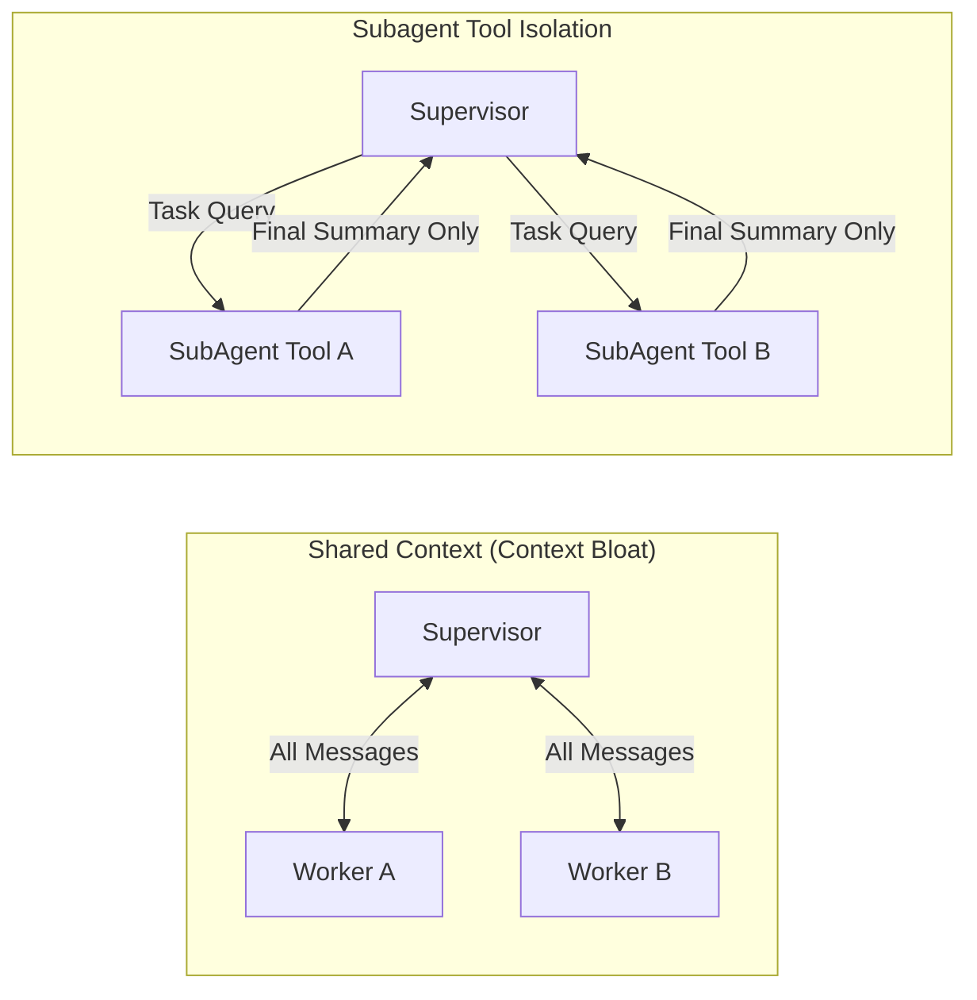

# Chapter 02: Multi-Agent Swarms & Hierarchical Teams

In this chapter, you will orchestrate multi-agent systems in two complementary ways:

1. **`SwarmPool` & `SubAgent`** — flat, context-isolated tool delegation that works with any `langcomp` `Agent`, LangGraph runnable, or plain Python sync/async callable.
2. **`Team`** — arbitrarily nested hierarchical subagent trees with transitive configuration inheritance, compiled over **DeepAgents** via `Team.compile()`.

---

## The Context Bloat Problem

Sharing raw message histories between a supervisor and multiple specialist workers quickly exhausts context windows and confuses downstream prompts.



Each `SubAgent` executes with its own isolated `thread_id` (auto-generated per call unless explicitly provided) and returns only its final output string to the supervisor.

---

## 1. Registering Subagents with `SwarmPool`

`SwarmPool` is a thread-safe registry for subagents (`Agent`, compiled LangGraph runnables, or plain sync/async callables). Names must match `^[A-Za-z0-9_-]{1,64}$`, and duplicate registrations raise `ConfigurationError` unless `overwrite=True` is passed.

```python
from langchain_core.messages import AIMessage
from langcomp import AgentBuilder, SwarmPool

def researcher_logic(state):
    query = state["messages"][-1].content
    return {"messages": [AIMessage(content=f"Research findings for '{query}': 3 key papers.")]}

def coder_logic(state):
    query = state["messages"][-1].content
    return {"messages": [AIMessage(content=f"Generated code for '{query}': def solve(): pass")]}

researcher_agent = AgentBuilder("ResearcherAgent").add_node("res", researcher_logic).compile()
coder_agent = AgentBuilder("CoderAgent").add_node("code", coder_logic).compile()

pool = SwarmPool("DevTeamSwarm")

pool.register(
    name="researcher",
    description="Specialized in technical research and paper summaries",
    agent_or_callable=researcher_agent,
    capabilities=["search", "documentation"],
)
pool.register(
    name="programmer",
    description="Specialized in writing and debugging Python code",
    agent_or_callable=coder_agent,
    capabilities=["python", "coding"],
)

print(len(pool), "researcher" in pool)  # 2 True
print(pool.list_subagents())
```

---

## 2. Running `SubAgent` Synchronously & Asynchronously (`run`, `arun`, `as_tool`)

Every registered entry is a `SubAgent` instance supporting:

- `sub.run(query, thread_id=None, config=None)` — synchronous execution
- `await sub.arun(query, thread_id=None, config=None)` — native async execution (supports `Agent.ainvoke`, runnable `.ainvoke`, and async callables)
- `sub.as_tool()` — converts the subagent into a sync + async LangChain `StructuredTool` accepting `task_description: str`

```python
import asyncio
from langcomp import SubAgent

async def async_linter(code: str) -> str:
    return f"Lint OK ({len(code)} chars)"

linter_sub = SubAgent(
    name="linter",
    description="Checks Python code style asynchronously",
    agent_instance=async_linter,
)

# Direct async execution
async def run_subagents() -> None:
    report = await linter_sub.arun("def solve(): pass")
    print(report)  # Output: Lint OK (17 chars)

    # Also works via the exported StructuredTool's async interface
    linter_tool = linter_sub.as_tool()
    tool_out = await linter_tool.ainvoke({"task_description": "x = 1"})
    print(tool_out)  # Output: Lint OK (5 chars)

asyncio.run(run_subagents())
```

### Wiring `SwarmPool` into a Supervisor Agent

Call `pool.get_tools()` and pass the tools straight into `langcomp.create_agent()`:

```python
from langchain_core.messages import AIMessage
from langcomp import FakeModel, create_agent

# Offline-runnable supervisor using FakeModel (swap for "openai:gpt-4o-mini" in production)
supervisor_model = FakeModel(
    script=[
        AIMessage(
            content="",
            tool_calls=[
                {
                    "name": "researcher",
                    "args": {"task_description": "Summarize attention in Transformers"},
                    "id": "call_1",
                    "type": "tool_call",
                }
            ],
        ),
        "Summary complete: the researcher found 3 key papers.",
    ]
)

supervisor = create_agent(
    model=supervisor_model,
    tools=pool.get_tools(),
    system_prompt="Delegate research and coding tasks to the specialist tools.",
    name="Supervisor",
)

result = supervisor.invoke("Summarize attention in Transformers")
print(result["messages"][-1].content)
# Output: Summary complete: the researcher found 3 key papers.
```

---

## 3. `langcomp.create_agent` vs `langchain.agents.create_agent` & Interop

Because both `langcomp` and LangChain 1.x export a function named `create_agent`, it helps to know how they relate:

| Factory | Returns | Best for |
| :--- | :--- | :--- |
| `langcomp.create_agent(...)` | `langcomp.Agent` (wrapping a hand-built `CompiledStateGraph`) | Lazy `"provider:model"` resolution, `langcomp` onion middleware (`AgentMiddleware`, `JumpTo`, built-in adapters), automatic `State` default hydration, explicit `thread_id` safety |
| `langchain.agents.create_agent(...)` / `deepagents.create_deep_agent(...)` | Raw compiled LangGraph runnable | Using upstream LangChain 1.x or DeepAgents runtimes directly |

`langcomp` interoperates seamlessly in **both** directions:

### Exporting `SubAgent`s to DeepAgents

```python
from langcomp import SwarmPool

def security_reviewer_logic(code: str) -> str:
    return f"No critical vulnerabilities found in snippet ({len(code)} chars)."

interop_pool = SwarmPool("CrossFrameworkPool")
reviewer = interop_pool.register(
    name="security_reviewer",
    description="Reviews code for security issues and line-level severity",
    agent_or_callable=security_reviewer_logic,
)

# Produces a CompiledSubAgent-shaped dict (for Agent/runnables)
# or a declarative dict with system_prompt (for plain callables)
deepagents_sub_dict = reviewer.to_deepagents_subagent_dict()

# Pass directly into DeepAgents (requires: pip install 'langcomp[deepagents]'):
# from deepagents import create_deep_agent
# deep_graph = create_deep_agent(
#     model="google_genai:gemini-2.5-flash",
#     subagents=[deepagents_sub_dict],
# )
```

### Wrapping External Runnables into `langcomp.Agent`

Any compiled LangChain 1.x `create_agent()` runnable or DeepAgents graph can be wrapped with `Agent.from_runnable()` to gain normalized payload handling, `GraphVisualizer`, and `DryRunner`:

```python
from langchain_core.tools import tool
from langcomp import Agent

@tool
def lookup_status(service: str) -> str:
    """Return current health status for a service."""
    return f"{service}: healthy"

# Example with LangChain 1.x create_agent (when `langchain` is installed):
# from langchain.agents import create_agent as lc_create_agent
# lc_runnable = lc_create_agent(model="openai:gpt-4o-mini", tools=[lookup_status])
# wrapped = Agent.from_runnable(lc_runnable, name="WrappedLCAgent")
```

---

## 4. Hierarchical Multi-Agent Trees with `Team`

When a flat pool is not enough, `langcomp.Team` lets you model arbitrarily nested hierarchies (e.g., Director -> Leads -> Specialists) and compile the entire tree into a **DeepAgents** graph with `Team.compile()`.

### Key Features of `Team`

- **Transitive Inheritance:** Optional fields (`system_prompt`, `tools`, `model`, `skills`, `middleware`) automatically inherit from parent to child unless explicitly overridden on a child `Team`.
- **Recursive Compilation:** Intermediate teams with `children` compile into DeepAgents `CompiledSubAgent` graphs; leaf teams compile into declarative subagent specs.
- **Built-in Safety Checks:**
  - Rejects duplicate sibling names and empty names (`ValueError`).
  - Rejects `"general-purpose"` as a child name so it cannot silently shadow DeepAgents' built-in general-purpose subagent (`ValueError`).
  - Detects cycles in `children` and enforces a maximum nesting depth of 32 (`ConfigurationError`).

> [!NOTE]
> Constructing and inspecting `Team` trees requires only core `langcomp`. Calling `Team.compile()` lazily imports `deepagents` and requires `pip install 'langcomp[deepagents]'` (Python >= 3.11).

```python
from langchain_core.tools import tool
from langcomp import Agent, Team

@tool
def search_docs(query: str) -> str:
    """Search internal engineering documentation."""
    return f"Doc hits for: {query}"

# Leaf specialists inherit model & tools unless overridden
api_specialist = Team(
    name="api_specialist",
    description="Designs REST and GraphQL contracts",
    system_prompt="Focus on API schemas, pagination, and backwards compatibility.",
)

db_specialist = Team(
    name="db_specialist",
    description="Designs relational schemas and indexes",
    system_prompt="Focus on PostgreSQL normalization, indexing, and query plans.",
)

# Intermediate lead owns child specialists
backend_lead = Team(
    name="backend_lead",
    description="Coordinates API and database engineering",
    system_prompt="Delegate API and DB questions to your specialists and synthesize.",
    children=[api_specialist, db_specialist],
)

# Root team sets shared defaults (model, tools) inherited transitively down the tree
engineering_director = Team(
    name="engineering_director",
    description="Top-level architecture coordinator",
    system_prompt="Break down architecture tasks and delegate to leads.",
    model="openai:gpt-4o-mini",
    tools=[search_docs],
    children=[backend_lead],
)

# Compile into a runnable DeepAgents graph (requires `langcomp[deepagents]`):
# deep_runnable = engineering_director.compile(checkpointer=saver)
# director_agent = Agent.from_runnable(deep_runnable, name="EngineeringDirector")
```

You can also override the root model at compile time via `engineering_director.compile(model="google_genai:gemini-2.5-flash")`.

---

## Summary Checklist

- [x] Use `SwarmPool` and `SubAgent` (`run`, `arun`, `as_tool`) for flat, context-isolated tool delegation.
- [x] Understand the difference between `langcomp.create_agent()` and `langchain.agents.create_agent()`, and use `Agent.from_runnable()` / `to_deepagents_subagent_dict()` for interoperability.
- [x] Use `Team` and `Team.compile()` for nested hierarchical multi-agent trees with transitive inheritance and cycle protection.
