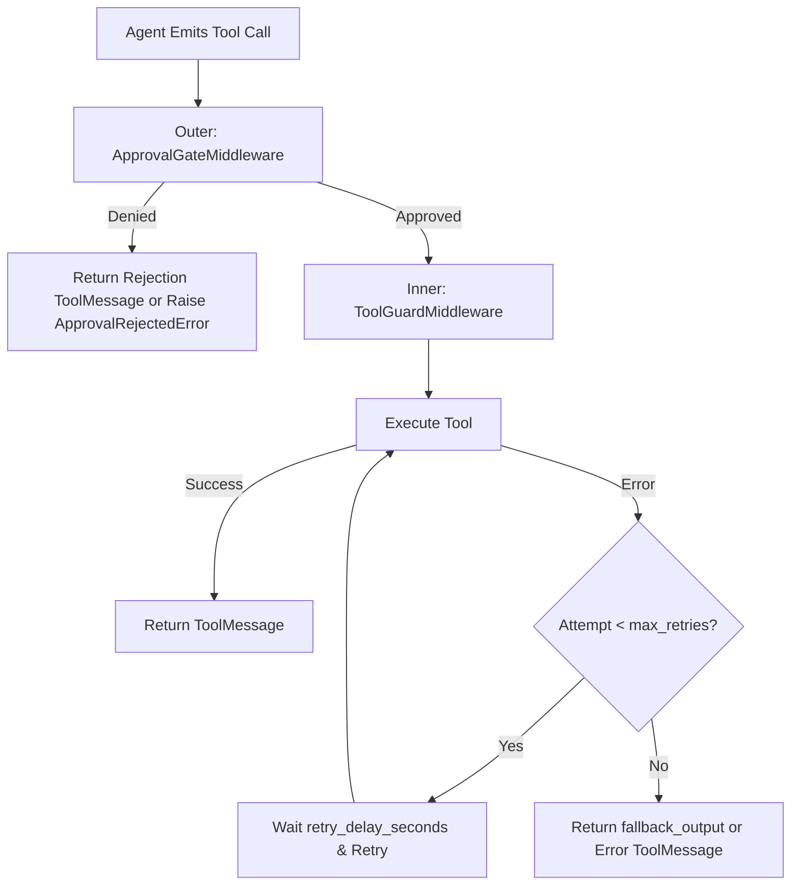

# Chapter 04: Tool Guards & Human Approval Gates

In this chapter, you will make tool execution resilient against transient failures with `ToolGuard`, enforce fail-closed human-in-the-loop policies with `ApprovalGate`, and compose `ApprovalGateMiddleware` and `ToolGuardMiddleware` safely inside an agent loop.

---

## 1. Resilient Tools with `ToolGuard`

External APIs, databases, and remote services fail intermittently. `ToolGuard` wraps sync or async Python callables and LangChain `BaseTool` instances with configurable retries (`max_retries >= 1`), backoff intervals (`retry_delay_seconds >= 0`), and optional fallback values.

### Key Semantics

- **Non-mutating:** `wrap_tool(tool_inst)` returns a Pydantic v2-safe cloned `BaseTool` without mutating the original tool instance.
- **Sync & async support:** `wrap_function()` automatically preserves sync vs. async signatures (`time.sleep` for sync, `await asyncio.sleep` for async).
- **`ToolExecutionError`:** When all attempts fail and `fallback_output` is `None`, `ToolGuard` raises `ToolExecutionError` (subclass of `LangcompError` and `RuntimeError`) chained to the last exception.
- **Control-flow & policy respect:** `ToolGuard` **never** retries or swallows `ApprovalRejectedError` or LangGraph `GraphBubbleUp` signals (such as `interrupt()`).

```python
from langchain_core.tools import tool
from langcomp import ToolExecutionError, ToolGuard

# Stateful closure (no mutable globals needed)
def make_flaky_fetcher(fail_times: int):
    attempts = 0

    def fetch_stock_price(symbol: str) -> str:
        nonlocal attempts
        attempts += 1
        print(f"Attempt #{attempts} fetching price for {symbol}...")
        if attempts <= fail_times:
            raise ConnectionError("Temporary network timeout")
        return f"Stock {symbol}: $150.25"

    return fetch_stock_price

# 1. Recovering via retries with a fallback safety net
guard_with_fallback = ToolGuard(
    max_retries=3,
    retry_delay_seconds=0.05,
    fallback_output="Service currently unavailable.",
)
guarded_fetch = guard_with_fallback.wrap_function(make_flaky_fetcher(fail_times=2))
print("Final Result:", guarded_fetch("AAPL"))
# Output: Final Result: Stock AAPL: $150.25

# 2. Raising ToolExecutionError when fallback_output is None
strict_guard = ToolGuard(max_retries=2, retry_delay_seconds=0.0)
always_failing = strict_guard.wrap_function(make_flaky_fetcher(fail_times=5))
try:
    always_failing("AAPL")
except ToolExecutionError as exc:
    print("Exhausted retries:", exc)

# 3. Non-mutating BaseTool clone
@tool
def calculate_tax(amount: float) -> float:
    """Calculate tax for a given amount."""
    return amount * 0.15

guarded_tax_tool = guard_with_fallback.wrap_tool(calculate_tax)
assert guarded_tax_tool is not calculate_tax  # original tool is untouched
```

---

## 2. Fail-Closed Human Approval with `ApprovalGate`

Sensitive actions (deleting database rows, sending external emails, transferring funds) should never run unapproved.

**`ApprovalGate` is fail-closed by default:** if constructed with `approval_func=None`, both `check_approval()` and `acheck_approval()` return `False`.

- `check_approval(action_name, parameters)` — synchronous policy check (raises `TypeError` if given an `async def` callback)
- `await acheck_approval(action_name, parameters)` — async policy check (accepts either sync or async callbacks)
- `wrap_function(func, action_name=None)` — non-mutating wrapper for sync/async functions; raises `ApprovalRejectedError` on denial
- `wrap_tool(tool_inst, action_name=None)` — non-mutating cloned `BaseTool` wrapper; extracts tool arguments cleanly (stripping LangChain framework-injected `run_manager`/`config` params) and raises `ApprovalRejectedError` on denial

```python
import asyncio
from langchain_core.tools import tool
from langcomp import ApprovalGate, ApprovalRejectedError

# Fail-closed default: denies everything until a policy is provided
locked_gate = ApprovalGate()
assert locked_gate.check_approval("drop_table", {"table": "users"}) is False

# Custom policy callback
def security_policy(action_name: str, parameters: dict) -> bool:
    if parameters.get("environment") == "production":
        return False
    return True

gate = ApprovalGate(approval_func=security_policy)

assert gate.check_approval("restart_service", {"environment": "staging"}) is True
assert gate.check_approval("drop_table", {"environment": "production"}) is False

# Non-mutating wrap_function & wrap_tool raise ApprovalRejectedError on denial
@tool
def deploy_service(service: str, environment: str) -> str:
    """Deploy a service to an environment."""
    return f"Deployed {service} to {environment}"

gated_deploy = gate.wrap_tool(deploy_service)
assert gated_deploy is not deploy_service

print(gated_deploy.invoke({"service": "billing", "environment": "staging"}))
# Output: Deployed billing to staging

try:
    gated_deploy.invoke({"service": "billing", "environment": "production"})
except ApprovalRejectedError as exc:
    print("Blocked:", exc)
# Output: Blocked: Action 'deploy_service' was not approved.

# Async approval callback
async def async_policy(action_name: str, parameters: dict) -> bool:
    return parameters.get("environment") != "production"

async def verify_async() -> None:
    async_gate = ApprovalGate(approval_func=async_policy)
    allowed = await async_gate.acheck_approval("deploy_service", {"environment": "staging"})
    assert allowed is True

asyncio.run(verify_async())
```

---

## 3. Agent-Loop Middleware: `ApprovalGateMiddleware` & `ToolGuardMiddleware`

Instead of manually wrapping every tool one by one, you can enforce approval and retries across an entire agent via middleware:

- **`ApprovalGateMiddleware(gate, guarded_tools=..., denial_message=..., raise_on_reject=False)`**
  - Checks every tool call (or only tool names in `guarded_tools`) via `gate.check_approval` / `gate.acheck_approval`.
  - When `raise_on_reject=False` (default), returns a structured error `ToolMessage` with `approval_rejected=True` so the model can see the denial and respond gracefully.
  - When `raise_on_reject=True`, raises `ApprovalRejectedError` immediately to halt execution.
- **`ToolGuardMiddleware(guard=..., max_retries=..., fallback_output=..., retry_delay_seconds=...)`**
  - Retries failing tool executions (both raised exceptions and `status="error"` `ToolMessage`s returned by the core tool invoker).
  - Never retries or applies `fallback_output` to `ApprovalRejectedError`, approval-rejected `ToolCallResponse`s, or `GraphBubbleUp`.

### Recommended Outer-to-Inner Middleware Ordering

Because `langcomp` composes `wrap_tool_call` middleware in **onion order** (the first middleware in the list is the outermost wrapper), always place **`ApprovalGateMiddleware` before `ToolGuardMiddleware`**:

```python
middleware = [
    ApprovalGateMiddleware(gate, guarded_tools=["delete_record"]),  # OUTER: checks policy once first
    ToolGuardMiddleware(max_retries=3, retry_delay_seconds=0.1),    # INNER: retries approved calls only
]
```

This guarantees that:
1. Approval is evaluated **once** before the tool executes—never re-prompted on retries.
2. Denied tool calls short-circuit immediately without entering retry loops or returning misleading fallback outputs.

### Complete Runnable Example

```python
from langchain_core.messages import AIMessage
from langchain_core.tools import tool
from langcomp import (
    ApprovalGate,
    ApprovalGateMiddleware,
    FakeModel,
    ToolGuardMiddleware,
    create_agent,
)

attempts = {"count": 0}

@tool
def fetch_invoice(invoice_id: str) -> str:
    """Fetch an invoice (flaky on first call)."""
    attempts["count"] += 1
    if attempts["count"] == 1:
        raise ConnectionError("Transient timeout")
    return f"Invoice {invoice_id}: PAID"

@tool
def delete_invoice(invoice_id: str) -> str:
    """Permanently delete an invoice."""
    return f"Deleted {invoice_id}"

gate = ApprovalGate(approval_func=lambda name, params: name != "delete_invoice")

model = FakeModel(
    script=[
        AIMessage(
            content="",
            tool_calls=[
                {"name": "fetch_invoice", "args": {"invoice_id": "INV-1"}, "id": "c1", "type": "tool_call"},
                {"name": "delete_invoice", "args": {"invoice_id": "INV-1"}, "id": "c2", "type": "tool_call"},
            ],
        ),
        "Fetched INV-1 after retry, and respected the deletion block.",
    ]
)

agent = create_agent(
    model=model,
    tools=[fetch_invoice, delete_invoice],
    middleware=[
        ApprovalGateMiddleware(gate, guarded_tools=["delete_invoice"]),
        ToolGuardMiddleware(max_retries=3, retry_delay_seconds=0.0),
    ],
)

result = agent.invoke("Inspect and delete INV-1")
print(result["messages"][-1].content)
# Output: Fetched INV-1 after retry, and respected the deletion block.
assert attempts["count"] == 2  # fetch_invoice succeeded on retry #2
```

---

## Guardrails & Safety Flow


