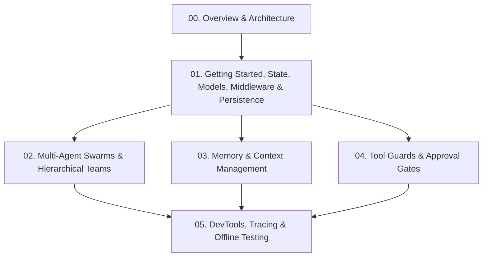

# `langcomp` Comprehensive Tutorial Suite (v0.2.0)

Welcome to the official, step-by-step tutorial suite for **`langcomp` (LangChain-Complementary)** — a high-level, developer-friendly framework that streamlines and complements [LangChain](https://docs.langchain.com), [LangGraph](https://docs.langchain.com/oss/python/langgraph/overview), and [DeepAgents](https://docs.langchain.com/oss/python/deepagents/overview).

---

## Learning Path Overview

This tutorial suite is organized into progressive chapters covering core agent construction, typed state, middleware, persistence, multi-agent orchestration, memory management, tool guardrails, and offline testing/observability.



---

## Chapters Table of Contents

| Chapter | Title | Topics Covered |
| :--- | :--- | :--- |
| **[Chapter 00](00_overview_and_architecture.md)** | **Overview & Architecture** | Ecosystem pain points, `CompiledStateGraph` positioning, v0.2.0 architecture (`State`/`Reduce`, `@node`, middleware, lazy models, persistence, `Team`, testing, tracing) |
| **[Chapter 01](01_getting_started.md)** | **Getting Started & Core Agents** | Optional install extras, `SmartState` vs `State`/`Reduce`, `@node(idempotent=True)`, `create_agent`, `AgentBuilder`, lazy provider registry (`resolve_model`, `register_provider`), onion middleware, `checkpointer`/`managed_checkpointer`/`async_checkpointer` (explicit `thread_id`), sync & async (`ainvoke`/`astream`), `@agent` |
| **[Chapter 02](02_multi_agent_swarms.md)** | **Multi-Agent Swarms & Teams** | `SwarmPool`, sync/async `SubAgent` (`run`, `arun`, `as_tool`), `langcomp.create_agent` vs `langchain.agents.create_agent`, `Agent.from_runnable`, DeepAgents interop, hierarchical `Team` (`Team.compile()`) |
| **[Chapter 03](03_memory_and_context.md)** | **Memory & Context Management** | Standalone primitives (`ContextBuffer`, `AutoSummarizer`) vs middleware adapters (`ContextBufferMiddleware`, `AutoSummarizerMiddleware`), tool-call-pair-safe trimming/summarization, `asummarize_messages` |
| **[Chapter 04](04_tool_guards_and_approval.md)** | **Tool Guards & Approval Gates** | Non-mutating `ToolGuard` (`wrap_function`, `wrap_tool`, `ToolExecutionError`), fail-closed `ApprovalGate` (`check_approval`, `acheck_approval`, `ApprovalRejectedError`), `ApprovalGateMiddleware` + `ToolGuardMiddleware` outer-to-inner ordering |
| **[Chapter 05](05_devtools_and_testing.md)** | **DevTools, Tracing & Offline Testing** | `FakeModel` (scripted turns, `calls`, `bound_tool_names`, `stream`), `run_and_snapshot`/`arun_and_snapshot` (`SnapshotMismatchError`), `TraceCollector` & `summarize()`, `Node.invoke_for_test()`, `GraphVisualizer` (`xray`), `DryRunner` (`run_step`/`arun_step`) |

---

## Prerequisites

- Python 3.10 or higher (Python 3.11+ is required for the optional `deepagents` extra used by `Team.compile()`)
- Basic familiarity with LLM agent concepts (messages, tools, state)
- Standard Python virtual environment tooling (`venv`, `uv`, or `conda`)

---

## Quick Installation

Core installation requires only `langchain-core`, `langgraph`, and `pydantic`:

```bash
git clone https://github.com/ar-sdadras/langchain-complementary.git
cd langchain-complementary
pip install -e .
```

Install optional extras only for the providers and backends you need:

```bash
# Model providers
pip install -e ".[openai]"       # OpenAI & OpenRouter (langchain-openai)
pip install -e ".[google]"       # Google Gemini (langchain-google-genai)

# Durable checkpointers
pip install -e ".[sqlite]"       # SQLite sync & async checkpointers
pip install -e ".[postgres]"     # PostgreSQL sync & async checkpointers

# Hierarchical teams & ASCII graph rendering
pip install -e ".[deepagents]"   # Required for Team.compile() (Python >= 3.11)
pip install -e ".[visualizer]"   # grandalf ASCII layout engine

# Everything (or dev tooling)
pip install -e ".[all]"
pip install -e ".[dev]"
```
